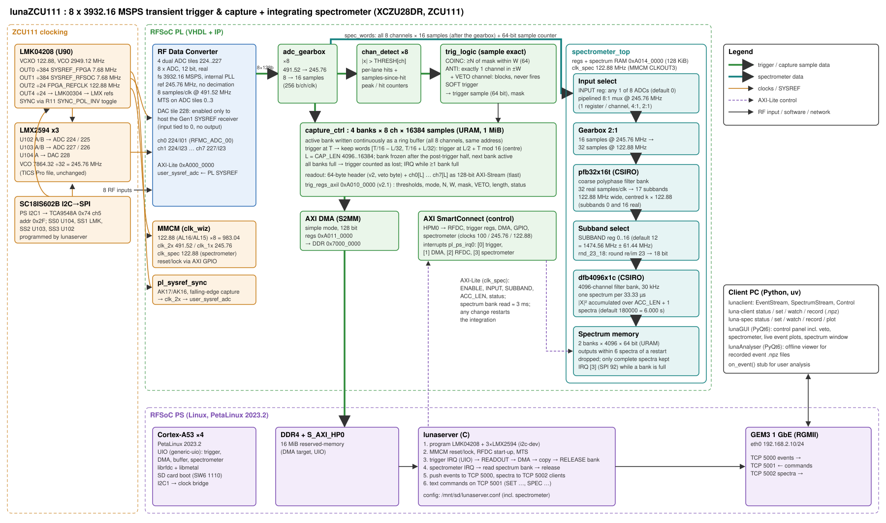

# lunaZCU111 – 8-channel 3.93 GS/s transient trigger and capture on the ZCU111, with an integrating spectrometer

This design uses the ZCU111 (XCZU28DR RFSoC) to digitise 8 RF inputs at **3932.16 MSPS** (ADC PLLs referenced to 245.76 MHz, multi-tile synchronised). The PL checks every sample on every channel against its own programmable threshold. The trigger is either **N-of-8 coincidence** or **anti-coincidence** within a sample-exact window (default 64 samples). In anti-coincidence mode one channel can be made a **veto**: it never starts a trigger, but its hit within the window blocks one. When it fires, **16384 samples** (programmable down to 4096) are captured on all 8 channels at the same time, with the trigger in the middle of the buffer. A server on the PS (Linux) gets an interrupt, reads each event by DMA and streams it over 1 GbE to clients. Thresholds and the rest of the configuration are set over the same link.

Any one of the 8 ADC channels (selectable, default 0) also feeds an **integrating spectrometer**:
- a 32/27 oversampled polyphase filter bank splits it into 17 coarse subbands, 122.88 MHz apart, each sampled at 145.64 MHz so that its own ±61.44 MHz band is free of aliasing (≤ −72 dB);
- a selectable subband goes to a 4096-channel filter bank with 35.556 kHz channels (145.64 MHz span; the central 3456 channels are the subband's own band);
- the power is integrated, 6.000 s by default;
- each integration is streamed on its own TCP port (5002).



The Vivado block design itself is in `docs/vivado_bd.svg` / `docs/vivado_bd.pdf`, generated by `hw/scripts/build_bd.tcl`.

**Status (2026-10-02): working on hardware and collecting data.**
- All VHDL simulations pass.
- The full build meets timing: WNS +0.109 ns, WHS +0.010 ns, PL SYSREF capture +0.46/+1.47 ns.
- Utilisation: 5.8 % LUTs, 32/80 URAM, 4 BRAM.
- PetaLinux 2023.2 images are built (`sw/petalinux/setup.sh`; the root file system is inside `image.ub`).
- The ZCU111 boots from the SD card through the FSBL (which loads the bitstream) and U-Boot to Linux. U-Boot needed `CONFIG_SYS_BOOTM_LEN=0x10000000` for the 110 MB kernel + initramfs; `setup.sh` applies this.
- Confirmed working on the board:
  - LMK04208/LMX2594 clock programming by `lunaserver`;
  - RFDC start-up and ADC multi-tile sync;
  - threshold triggering in the PL;
  - DMA readout of captured events;
  - streaming to the network client, which collects event data.
- Harmless console messages: `I/O error, dev mtdblock0` (the unused QSPI flash) and the U-Boot environment/MAC/SATA warnings.

**Spectrometer (branch `spectrometer`):**
- **Done:**
  - HDL, block design, server (`SPEC` commands, TCP 5002), client (`luna-spec`) and lunaGUI (spectrometer panel and spectrum window);
  - input select: any of the 8 ADCs can feed the spectrometer (`SET SPEC_INPUT`, spectrometer v1.1);
  - the server, client and lunaGUI tested end to end in simulation mode;
  - xsim with the real CSIRO cores (`hw/sim/run_sim.sh spec`) passes:
    - data test: with INPUT = 5, test tones on ADC 5 at +25 and −100 fine channels in subband 12 appear in fine channels 25 and 3996, with the expected 16:1 power ratio and about 50 dB to the neighbouring channels; a decoy tone on another ADC does not appear;
    - restart test: shortening the integration part way through gives a clean integration about 6 spectra plus one integration later;
  - the trigger simulations still pass, with the extra gearbox register stage;
  - the FPGA build meets timing:
    - WNS +0.013 ns (gearbox 491.52 → 245.76 MHz half-period transfer), WHS +0.010 ns;
    - `clk_spec` domain +2.05 ns;
    - PL SYSREF capture +0.75 ns;
  - utilisation: 9.4 % LUTs, 696 DSPs (16 %), 34/80 URAM, 44.5 BRAM. The CSIRO PFB alone is 646 DSPs; the input selector adds about 500 LUTs and 2100 registers.
- **Tested on the board** (October 2026, with the `veto` build).

**Veto (branch `veto`, built on the spectrometer branch):**
- **Done:**
  - HDL: VETO register (0x0A8, trigger core v2.1) and the veto in `trig_logic`; the event header (version 2) records the VETO register in byte 52;
  - server (`SET VETO <0-7|OFF>`, `veto=` in `GET CONFIG`/`STATUS`, saved in `lunaserver.conf`), client (`luna-client set --veto`, `Event.veto`/`veto_channel`, `veto` in the `.npz`), lunaGUI (veto selector) and lunaAnalyser (shows the veto channel);
  - the server detects the VETO register from the VERSION register; with an older bitstream it reports `veto=absent` and refuses `SET VETO`;
  - xsim: the trigger model matches on 31 configurations (9 with a veto channel), and the capture test checks that the veto channel alone does not trigger, that it blocks a nearby hit on another channel, and the header veto byte;
  - the FPGA build (with the spectrometer) meets timing: WNS +0.149 ns, WHS +0.010 ns, `clk_spec` +2.75 ns, PL SYSREF capture +0.34 ns setup / +1.55 ns hold; 9.43 % LUTs (the veto adds about 120), 696 DSPs, 34/80 URAM, 44.5 BRAM. SD images built.
- lunaGUI can also log each channel's threshold, hits/s, triggers/s and noise peak to a CSV file at every status poll (*Log channel rates*).
- **Tested on the board** (October 2026).

**Oversampled coarse filter bank (branch `veto-osfb`, built on `veto`; spectrometer v2.0):**
- **Done:**
  - the critically sampled CSIRO `pfb32x16t` + `rnd_23_18` are replaced by `ospfb` (our VHDL): 32 branches oversampled 32/27, 512-tap equiripple prototype, only the selected subband computed. `clk_spec` is now fs/27 = 145.636 MHz (MMCM CLKOUT0 ÷ 6.75), fed through a 16→27 gearbox and an async FIFO. Fine channels are 35.556 kHz (span 145.64 MHz, 3456 channels in the subband's own band), a spectrum is 28.125 µs, the default 6 s is 213333 spectra;
  - server (PFB_CFG detection, `GET SPEC` decim/span/tspec/band_chans/fifo_err, frame version 3 with the decimation in the flags, integration time saved in seconds), `lunaclient` (`Spectrum.fine_hz`, `in_band()`, …), `luna-spec` and lunaGUI (band edges marked, peak taken inside the band);
  - xsim: `ospfb` is bit-exact with `hw/sim/ospfb_model.py` on subbands 0, 1, 7, 12, 15, 16; the full spectrometer with the CSIRO DFB (`run_sim.sh spec`, ~10 min) puts the tones in channels 25/3996 at 16.00:1, a +65 MHz tone in channel 1828 at the predicted −1.9 dB, and an aliasing +90 MHz tone 73 dB down; the restart test and the trigger/capture tests still pass;
  - the FPGA build meets timing: WNS +0.029 ns (the clk_2x → clk_1x gearbox transfer), WHS +0.009 ns, `clk_spec` +0.546 ns, clk_1x → clk_spec FIFO +3.1 ns, PL SYSREF capture +0.30 ns setup / +1.20 ns hold (clk_2x/clk_1x carry a 0.763 ns phase shift to keep this centred with the new 983.04 MHz VCO); 7.7 % LUTs, 6.2 % registers, 661 DSPs (15.5 %), 34/80 URAM, 44.5 BRAM. SD images built.
- **Not yet tested on the board.**

## Contents

| Path | What |
|------|------|
| `hw/hdl/*.vhd` | VHDL: gearbox, detector, trigger logic, capture banks, readout, registers, SYSREF capture, spectrometer (`spectrometer_top`, `gearbox_16_27`, `ospfb` + generated `ospfb_pkg`, `spec_regs_axil`) |
| `hw/sim/` | xsim testbenches, Python golden models (`ospfb_model.py`: bit-exact model of the coarse filter bank), `run_sim.sh` (`spec`: spectrometer with the CSIRO DFB core) |
| `hw/scripts/gen_ospfb_coefs.py` | designs the coarse filter bank's 512-tap prototype and writes `hw/hdl/ospfb_pkg.vhd` and `hw/sim/ospfb_coefs.json` (needs scipy: `uv run --no-project --with numpy --with scipy ...`) |
| `hw/scripts/build_bd.tcl` | Vivado block design (PS, RFDC, MMCM, DMA, spectrometer, interconnect, IRQs) |
| `hw/scripts/spec_ip.tcl` | creates the CSIRO DFB IP instance from `refernces/PFB/dfb4096x1c_v2_0` |
| `hw/scripts/build.tcl` | unattended build → bitstream + `hw/build/lunaZCU111.xsa` |
| `hw/scripts/export_bd_image.tcl` | exports the Vivado BD picture (GUI mode) |
| `hw/constraints/zcu111.xdc` | PL reference clock and PL SYSREF pins |
| `sw/server/` | `lunaserver` (C): clocks, RFDC/MTS, trigger IRQ, DMA, spectrometer readout, TCP |
| `sw/client/` | Python client library, `luna-client` (events) and `luna-spec` (spectra) CLIs, and `lunaGUI` (PyQt6) control panel/plots (uv project) |
| `sw/lunaAnalyser/` | `lunaAnalyser` (PyQt6): offline viewer for recorded events – steps through a directory of `.npz` files with lunaGUI's plots, markers and PNG export (uv project) |
| `sw/petalinux/` | PetaLinux 2023.2 layer (device tree, kernel config, recipe) + `setup.sh` |
| `docs/` | block diagram, register map, network protocol |
| `refernces/` | TICS Pro clock files (as supplied); the ZCU111 user guide and schematic PDFs are not in git, see `refernces/README.md` |
| `refernces/PFB/dfb4096x1c_v2_0/` | CSIRO System Generator 2018.2 fine filter bank core (IP repository: `component.xml`, generated HDL, sub-core `.xci`/`.coe`), needed by the FPGA build and `run_sim.sh spec`. The v1.x coarse cores (`pfb32x16t_v1_6`, `rnd_23_18_v1_0`) are not used and not in git |

## Tools

| Tool | Status |
|------|--------|
| Vivado / Vitis 2023.2 (`~/Xilinx`) | installed. Licence from `~/Xilinx/license.sh` (XCZU28DR needs an Enterprise licence) |
| aarch64 cross-compiler (Vitis `gnu/aarch64`) | installed |
| Python 3 + numpy, uv | installed |
| PetaLinux 2023.2 | installed (`~/Xilinx/Petalinux/2023.2`; `setup.sh` also looks in `~/Xilinx/PetaLinux/2023.2`). ZCU111 BSP: `~/Xilinx/xilinx-zcu111-v2023.2-10140544.bsp` |
| PetaLinux host packages | `sudo apt install gcc-multilib libncurses-dev texinfo libtool-bin xterm net-tools pax diffstat chrpath socat bc python3-pip` and `sudo dpkg-reconfigure dash` → **No** (`/bin/sh` must be bash) |

Keep Vivado parallelism at 2–4 jobs. More jobs run out of memory on this 16 GB WSL2 machine.

## Build

```bash
# 1. VHDL unit simulations (≈3 min), including the coarse filter bank against
#    its bit-exact model (run_sim.sh os)
hw/sim/run_sim.sh
#    spectrometer with the real CSIRO DFB core (refernces/PFB, ~30 min)
hw/sim/run_sim.sh spec

# 2. FPGA: block design, synthesis, implementation, bitstream, XSA (about 1 h)
source ~/Xilinx/license.sh
cd hw/build && vivado -mode batch -source ../scripts/build.tcl -tclargs all 3
#   -> hw/build/lunaZCU111.xsa, lunaZCU111.bit, timing_summary.rpt
#   optional picture of the Vivado BD (opens a window briefly):
vivado -mode gui -source ../scripts/export_bd_image.tcl

# 3. Linux (after installing PetaLinux 2023.2; optionally pass the ZCU111 BSP)
sw/petalinux/setup.sh [--bsp ~/Downloads/xilinx-zcu111-v2023.2-final.bsp]
#   -> copy BOOT.BIN, image.ub, boot.scr to the SD card FAT partition
#      (a copy is kept in sw/petalinux/sd_card/; build_images.sh rebuilds an existing project)
#   ZCU111 SW6[4:1] = OFF,OFF,OFF,ON  (SD boot, UG1271 table 2-4)

# 4. Client (on the remote PC, host on 192.168.2.0/24)
cd sw/client && uv sync
uv run luna-client status
uv run luna-client set --thresh 8000 --mode coinc --n 2 --window 64 --mask 0xff --len 16384 --save
uv run luna-client set --mode anti --mask 0x7f --veto 7  # anti-coincidence, ch7 = veto (--veto off)
uv run luna-client record -o data/        # saves events as .npz
uv run luna-spec status
uv run luna-spec set --input 0 --subband 12 --tint 6 --on --save
uv run luna-spec record -o spectra/ --skip-first   # one .npz per integration
uv run --extra plot luna-spec plot                 # live spectrum plot
```

To test the server and client without hardware (on any Linux PC):

```bash
cd sw/server && make host && ./lunaserver-host -s 10 -c /tmp/luna.conf   # 10 synthetic events/s
cd sw/client && LUNA_HOST=127.0.0.1 uv run luna-client watch
cd sw/client && LUNA_HOST=127.0.0.1 uv run luna-spec watch   # synthetic spectra
```

## Versions and development

- **Releases** are git tags. Each one has a GitHub release with the SD card images (`BOOT.BIN`, `image.ub`, `boot.scr`), the XSA, the bitstream and the timing/utilisation reports, because build outputs are not tracked in git.
  - `v1.0`: first working hardware release (firmware VERSION 1.0, protocol version 1).
  - Branch `veto` (not released yet): firmware VERSION 2.1 (major 2 = spectrometer, minor 1 = VETO register), event header version 2, spectrum header version 2.
- **New features** are developed on a branch checked out in its own folder with `git worktree`, so the released design stays built and bootable alongside them:

  ```bash
  git worktree add -b <feature> ../lunaZCU111-<feature>   # new folder on a new branch
  git worktree list
  git worktree remove ../lunaZCU111-<feature>             # after merging into main
  ```

  Each worktree has its own `hw/build/` and PetaLinux project. `setup.sh` points all of them at one shared download/sstate cache (`~/Xilinx/plnx-cache`, override with `PLNX_CACHE`), so a second PetaLinux build reuses the first one's results. Run only one Vivado or PetaLinux build at a time on this 16 GB machine.
- **Block design changes** must go into `hw/scripts/build_bd.tcl` (edit it, or `write_bd_tcl` after GUI changes). The Vivado project in `hw/build/` is regenerated and is not in git.
- **Version numbers:** bump the firmware `VERSION` register (`trig_regs_axil.vhd`, major.minor) and `LUNA_PROTO_VERSION` (`protocol.h`) when the register map or network frames change, so mismatched firmware, server and client are detected.

## Design notes

**Clocks** (taken from `refernces/`, UG1271 and schematic 0381811):
- LMK04208 U90, VCO 2949.12 MHz:
  - OUT0 ÷384 → **PL SYSREF 7.68 MHz** (AK17/AK16)
  - OUT1 ÷384 → **analog SYSREF** (DAC tile 228 pins)
  - OUT2 ÷24 → **PL reference 122.88 MHz** (AL16/AL15)
  - OUT4 → LMX2594 references
- The stock TICS Pro file runs every output at 122.88 MHz. `sw/server/gen_clk_tables.py` changes only the OUT0/OUT1 dividers. The server then issues a SYNC so that the SYSREF edges are phase-aligned with the 122.88 MHz outputs.
- LMX2594 ×3: the supplied 245.76 MHz file, unchanged.
- Everything is programmed by `lunaserver` through PS I2C1 → TCA9548A (0x74) port 5 → SC18IS602B (0x2F).

**RFDC:**
- 4 dual ADC tiles, real input, 1× decimation, 8 samples per 491.52 MHz clock. 8 samples per clock is the IP maximum, so the RFDC interface must run at 491.52 MHz.
- The data is immediately regrouped to 16 samples at 245.76 MHz. All trigger and capture logic runs at 245.76 MHz.
- **DAC tile 228 is enabled but unused.** The Gen1 driver runs the SYSREF master through DAC tile 0 even for ADC-only MTS (`xrfdc_mts.c`). Its input is tied to zero, and nothing is connected to its output.

**Trigger:**
- Every sample is compared (|x| > threshold, per channel).
- Per lane, the detector also tracks the number of samples since the last hit. This makes the window test exact at the sample level, across clock-cycle boundaries.
- The definitions are in `docs/protocol.md` and `hw/hdl/trig_logic.vhd`. They are verified against a brute-force Python model on 31 configurations: N=1..8, windows 1–255, masks, anti-coincidence, veto.
- **Veto** (anti-coincidence only, VETO register): each channel has two roles, registered from the configuration. It may *start* a trigger if it is in the mask and is not the veto channel. Its hits *block* other channels if it is in the mask or is the veto channel. So the veto channel never triggers, but a hit on it within ±W of a candidate blocks the trigger, whether or not it is in the mask. With the veto off this is plain anti-coincidence. In coincidence mode the VETO register is ignored.

**Capture:**
- 4 banks × 8 channels × 16384 × 16 bit in UltraRAM (32 of 80 URAMs).
- The next event can be captured while earlier ones are being read. The only dead time is L/2 samples of pre-trigger refill (2.1 µs at L = 16384). When all 4 banks are waiting, triggers are counted in `LOST_COUNT`.

**Readout:**
- Readout is DMA to a 16 MiB reserved DDR region, then copied to RAM and the bank is released.
- Network sending is asynchronous, with a per-client queue. A slow client loses frames; the capture is never blocked.
- One 16384-sample event is 256 KiB, so 1 GbE carries about 400 events/s.

**Spectrometer** (`hw/hdl/spectrometer_top.vhd`, one ADC channel):
- **Input select:** the trigger core passes all 8 channels' 16-sample words (`spec_words`) and its sample counter (`spec_ts`) to the spectrometer. The INPUT register (`SET SPEC_INPUT`, default 0) picks one with a pipelined 8:1 mux at 245.76 MHz: one register per channel, then 4:1, then 2:1.
- **Clock:** `clk_spec` = fs/27 = 145.636 MHz, from the MMCM's fractional output (CLKOUT0, 983.04 MHz / 6.75); `clk_2x` and `clk_1x` moved to CLKOUT1/2. `gearbox_16_27` regroups the 16 samples per `clk_1x` cycle into words of 27 samples (16 words every 27 cycles), which cross to `clk_spec` through an XPM asynchronous FIFO (read every cycle once half full; the two rates are exactly equal).
- **Coarse filter bank:** `ospfb` (our VHDL, spectrometer v2.0), a 32-branch real polyphase filter bank oversampled 32/27 with a 512-tap equiripple prototype (`hw/scripts/gen_ospfb_coefs.py`). Subbands are 122.88 MHz apart, subband k centred on k × 122.88 MHz and sampled at 145.636 MS/s complex. It is flat to ±58 MHz, −0.5 dB at the ±61.44 MHz subband edges, −3 dB at ±66.5 MHz, and anything that aliases into ±61.44 MHz is ≤ −72 dB. With the critically sampled CSIRO `pfb32x16t` of v1.x the edges were −6 dB and the outer fine channels held aliases of the neighbouring subband.
  - **Only the selected subband is computed** (SUBBAND register, default 12 = 1474.56 MHz): a polyphase FIR of 32 systolic 16-tap DSP chains, a single-bin DFT (pairs pre-added, 31 multipliers), and a rotation by e^(−j2πk·27m/32) that accounts for the decimation by 27 rather than 32 and also corrects the filter gain. Subbands 0 and 16 are real.
  - The output (18 bit) has the same scale as the old `pfb32x16t` + `rnd_23_18`: a passband tone of peak A codes gives |out| = 32·A.
- **Fine filter bank:** `dfb4096x1c`, 4096 channels of 35.556 kHz spanning 145.636 MHz, with power and accumulation over ACC_LEN + 1 spectra of 28.125 µs. The default is 213333 spectra = 6.000 s. The central 3456 channels (±61.44 MHz) are the subband's own band; the outer 640 overlap the neighbouring subbands (lunaGUI and `luna-spec plot` mark the band edges).
- **Storage:** each integration is written to one of 2 banks of 4096 × 64 bit in UltraRAM. An interrupt (SPI 92) tells `lunaserver`, which reads the bank over AXI-Lite (about 3 ms) and sends it to every client on TCP 5002.
- **Control:** enable/disable, input, subband and integration time are set on the control port (`SPEC ON|OFF`, `SET SPEC_INPUT`, `SET SPEC_SUBBAND`, `SET SPEC_TINT`), or from lunaGUI. Any change restarts the integration immediately. The FPGA discards the filter bank's output until it has re-synchronised (about 6 spectra), so the first integration after a change is clean; it is flagged "first after restart" for information.
- **The CSIRO DFB core is in this repository:**
  - It is in `refernces/PFB/dfb4096x1c_v2_0/`, exported from System Generator 2018.2 as an IP-catalog core, so a fresh clone has everything needed to rebuild the design.
  - `hw/scripts/spec_ip.tcl` creates it as an IP-catalog instance (`LUNA_PFB_IP` can point at another copy), and the build stops with a clear message if it is missing.
- **Software:** the server reads PFB_CFG (decimation 27) and reports `decim`, `span_mhz`, `fine_khz`, `tspec_us` and `band_chans` in `GET SPEC`; spectrum frames (version 3) carry the decimation in flags[15:8], so `lunaclient` gets the channel width right for both v1 and v2 bitstreams. The integration time is saved in seconds, so a saved 6 s stays 6 s.

## Bring-up checklist

1. Boot and `ping 192.168.2.10`. The serial console is on the USB-UART (J83), 115200 baud.
2. `journalctl -u lunaserver` (or `/var/log/lunaserver.log`) should show:
   - clocks programmed;
   - MMCM locked;
   - 4 ADC tiles PLL-locked at 3932.160 MHz;
   - `ADC multi-tile sync OK` with the per-tile latencies.

   The LEDs DS34/DS35/DS44 (LMX lock) and DS45 (LMK) should be on.
3. `luna-client status`: `sysref` must increase at 7.68 MHz between two calls, and `rfdc=up mts=ok`.
4. With no inputs, run `luna-client cmd "GET PEAKS"` to see the noise level. Set the thresholds a few times above it.
5. Run `luna-client cmd SOFTTRIG`, then `luna-client watch`. You should get an event with src `soft`.
6. Split one pulse (a few ns long) to all 8 inputs. The events should show the pulse at the same sample on every channel (MTS alignment) and at `trig_offset`. Check `N` and anti-coincidence with subsets of the channels.

Spectrometer (bitstream with trigger-core VERSION 2.x):

7. The server log should show `spec: spectrometer v2.0, 2 banks` and `coarse filter bank 32 branches, 16 taps each, decimation 27 (oversampled 32/27): fine channel 35.556 kHz, spectrum 28.125 us`. Then `luna-spec status` should show `present 1`, `enabled 1`, `input 0`, `subband 12`, `tint 5.999991`, `decim 27`, `fine_khz 35.556`, `fifo_err 0`.
8. Feed a CW tone into ADC 0 (RFMC_ADC_00), for example 1476.06 MHz: the centre of subband 12 (1474.56 MHz) + 1.5 MHz. `luna-spec watch` should show the peak at 1476.06 MHz (to within one 35.6 kHz channel) every 6 s, and `luna-spec plot` should show it on the plot.
9. `luna-spec set --subband 11`: the tone (+124 MHz from that centre) should disappear from the spectrum (≥ 70 dB down). Change back with `--subband 12`.
9a. Oversampling: move the tone to 1539.56 MHz (subband 12 centre + 65 MHz). In subband 12 it appears outside the dashed band edges, about 2 dB down; with `--subband 13` it appears at its full level at −57.9 MHz from that centre, inside the band. With the v1.x bitstream the same tone in subband 12 showed up aliased at −57.9 MHz, only ~12 dB down.
10. `luna-spec set --tint 0.1`: integrations should arrive every 0.1 s, with `lost 0` and `dropped 0`. Change back with `--tint 6 --save`.
11. Move the tone to another input, for example ADC 5, then `luna-spec set --input 5`: the tone should appear again, and `luna-spec watch` should show `ADC 5`. With `--input 0` it should be gone. lunaGUI's *Spectrometer* panel and spectrum window should show the same.

Veto (bitstream with trigger-core VERSION 2.1):

12. The server log should show `pl: trigger core v2.1, 4 capture banks, veto`, and `luna-client status` should show `veto=OFF`.
13. `luna-client set --mode anti --veto 7`. A pulse on channel 7 alone should give no event. A pulse on channel 0 alone should trigger, and `luna-client watch` should show `veto ch7`. The same pulse split to channels 0 and 7 should give no event. `--veto off` restores plain anti-coincidence.

## Troubleshooting and performance notes

These were the open items before bring-up; the design now works on hardware, but they are the places to look if a rebuild or a new board misbehaves.


- **LMK04208 SYNC:**
  - The ÷384 SYSREF outputs are aligned by toggling SYNC_POL_INV.
  - If MTS reports `PL SysRef may not have been captured synchronously`, adjust the SYSREF input delay: either the capture edge in `pl_sysref_sync.vhd`, or the LMK CLKout0 digital/analog delay.
- **DMA copy speed:**
  - The DMA buffer is mapped uncached through UIO, and copied with aligned 16-byte loads.
  - If a higher event rate is needed, switch to `u-dma-buf` (cached with sync) or read directly into socket buffers.
- **Device-tree labels:**
  - `system-user.dtsi` refers to the generated labels `trigger_capture`, `dma` and `mmcm_gpio`, and to the node `dma-channel@a0110030`.
  - If `petalinux-build` stops at a label error, check `components/plnx_workspace/device-tree/device-tree/pl.dtsi` and fix the names.
